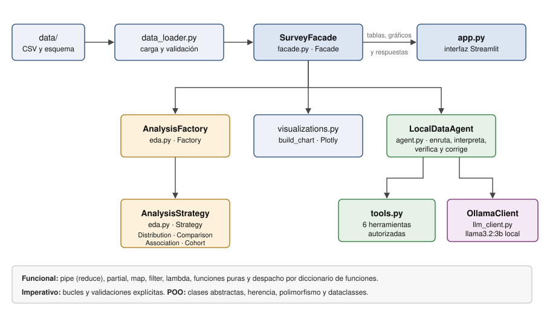

# Proyecto final: IA en la comunidad de desarrollo

Aplicación local en Streamlit que analiza cómo usan, valoran y confían en la
inteligencia artificial las personas que respondieron la Encuesta de
Desarrolladores 2025 de Stack Overflow. Combina análisis descriptivo con
Python, gráficos con Plotly y un agente que interpreta los resultados con un
modelo local de Ollama.



## Dataset y problema

| Elemento | Detalle |
|---|---|
| Fuente | [Stack Overflow Developer Survey 2025 en Kaggle](https://www.kaggle.com/datasets/aliaslam25/stack-overflow-developer-survey-2025) (Ali Aslam), copia de la [encuesta oficial](https://survey.stackoverflow.co/2025/) publicada bajo licencia ODbL 1.0 |
| Archivos | `data/data.csv` (respuestas, 49 123 filas × 170 columnas, 134 MB) y `data/schema.csv` (diccionario de preguntas) |
| Variables usadas | `ResponseId`, `MainBranch`, `Age`, `WorkExp`, `DevType`, `AISelect`, `AIAgents`, `AISent`, `AIAcc` |

La [metodología oficial](https://survey.stackoverflow.co/2025/methodology)
informa 49 009 respuestas en los resultados publicados; la copia local tiene
49 123, por lo que sus porcentajes no deben compararse cifra por cifra con el
informe oficial.

**Problema analítico:** relacionar la frecuencia de uso de herramientas de IA
con la actitud, la confianza en su precisión y el uso de agentes, y comparar el
uso diario entre grupos de edad, experiencia, rol y relación con la
programación.

**Criterios de cálculo:** cada porcentaje usa como base las respuestas válidas
de su pregunta. En los cruces, la base es cada frecuencia de uso; en las
cohortes, cada grupo, y solo se muestran los grupos con al menos 100
respuestas. El análisis es descriptivo y no permite inferir causalidad.

## Instalación y ejecución

Requiere Python 3.10 o superior (probado con Python 3.13 y Ollama 0.21).

1. Crear y activar el entorno virtual, e instalar las dependencias:

   ```bash
   python3 -m venv .venv
   source .venv/bin/activate          # Windows: .venv\Scripts\activate
   python -m pip install -r requirements.txt
   ```

2. Obtener el dataset. `data/data.csv` no se versiona porque supera el límite
   de 100 MB de GitHub:
   - Descargar el dataset desde Kaggle:
     <https://www.kaggle.com/datasets/aliaslam25/stack-overflow-developer-survey-2025>
     (requiere una cuenta gratuita).
   - Copiar `survey_results_public.csv` como `data/data.csv`.
   - `data/schema.csv` ya está en el repositorio; corresponde a
     `survey_results_schema.csv` de la misma descarga.

3. Instalar [Ollama](https://ollama.com/download), iniciar el servicio y
   descargar el modelo:

   ```bash
   ollama pull llama3.2:3b
   ```

   En equipos con pocos recursos se puede usar `llama3.2:1b` y escribir ese
   nombre en la barra lateral de la aplicación.

4. Ejecutar la aplicación:

   ```bash
   python -m streamlit run app.py
   ```

Las pestañas de datos y análisis funcionan aunque Ollama no esté disponible.
En ese caso, el agente elige la herramienta por reglas, muestra solo el
resultado calculado y avisa que no hay interpretación del modelo.

## Estructura

```text
app.py                    interfaz Streamlit (solo presentación)
src/data_loader.py        carga, validación de columnas y perfil
src/eda.py                funciones analíticas, Strategy y Factory
src/visualizations.py     gráficos Plotly y selección por tipo de análisis
src/facade.py             Facade: punto único de acceso para la interfaz
src/tools.py              herramientas autorizadas para el agente
src/agent.py              agente: enrutamiento, interpretación y verificación
src/llm_client.py         cliente HTTP de Ollama
data/schema.csv           diccionario de variables
data/data.csv             respuestas (no versionado)
assets/                   diagrama de arquitectura y capturas
informe/                  borrador del informe final
```

## Paradigmas de programación

| Paradigma | Dónde se aplica |
|---|---|
| Funcional | `eda.py`: `pipe` con `functools.reduce` compone las transformaciones puras de `prepare_analysis`; `add_flag` es una función de orden superior que se especializa con `partial`; `indicator_summary` usa `map` y `large_groups` usa `filter`. `visualizations.py`: el diccionario de funciones `CHART_BUILDERS` sustituye los condicionales. `agent.py`: `normalize`, `keyword_route`, `verify_answer` y el generador recursivo `context_numbers`. |
| Imperativo | `association_contrast` y `check_columns` (bucles `for` con acumulación y validación), `Tool.validate` y el flujo de la interfaz en `app.py`. |
| Orientado a objetos | La clase abstracta `AnalysisStrategy` y sus cuatro subclases (herencia y polimorfismo); `SurveyFacade`, `OllamaClient` y `LocalDataAgent` (encapsulamiento); `Tool`, `ToolResult`, `Verification` y `AgentResponse` (`dataclasses`). |

## Patrones de diseño

- **Strategy:** `AnalysisStrategy.run()` define el contrato común.
  `DistributionStrategy`, `ComparisonStrategy`, `AssociationStrategy` y
  `CohortStrategy` lo implementan de forma intercambiable.
- **Factory:** `AnalysisFactory.create(kind)` instancia la estrategia a partir
  de su nombre, de modo que ni la interfaz ni el agente usan condicionales para
  elegir el análisis.
- **Facade:** `SurveyFacade` oculta la carga, la preparación, la fábrica, los
  gráficos y la construcción del agente. `app.py` solo conversa con la fachada.

## Agente de IA

El agente (`LocalDataAgent`) apoya el análisis, pero no lo reemplaza: Python
hace todos los cálculos y el modelo solo elige una herramienta e interpreta el
resultado. El flujo es:

1. **Enrutamiento.** El agente elige una de las seis herramientas de
   `tools.py`: `indicadores`, `calidad`, `distribucion`, `asociacion`,
   `cohorte` o `comparacion`. La interfaz usa el modo híbrido: si la pregunta
   contiene palabras clave explícitas, la regla decide; si es una pregunta
   abierta, Ollama elige en modo JSON. `LocalDataAgent.route` también admite
   los modos `"modelo"` y `"reglas"`. Los argumentos se validan contra una
   lista cerrada de valores; si el modelo propone algo no autorizado, se usan
   las reglas.
2. **Ejecución.** La herramienta calcula una tabla para la interfaz y un
   contexto compacto para el modelo, con `hechos_clave` redactados por Python
   (porcentaje, casos y base). El CSV completo nunca se envía al modelo.
3. **Interpretación.** `llama3.2:3b` responde en español a partir de esos
   hechos, sin aplicar fórmulas, con temperatura 0 y semilla fija para que
   sea reproducible.
4. **Verificación.** `verify_answer` extrae cada cifra no trivial de la
   respuesta y comprueba que exista en el contexto calculado. Si hay cifras
   sin respaldo, el agente pide al modelo una corrección y la interfaz muestra
   cuáles quedaron sin verificar.

La verificación confirma que cada cifra exista en el cálculo, pero no que esté
bien asociada a su grupo. Por eso la interfaz muestra siempre la tabla
calculada junto a la respuesta.

## Entrega académica

- Borrador del informe: [informe/Informe_Proyecto_Final.md](informe/Informe_Proyecto_Final.md).
- El informe final se entrega en PDF (máximo 15 páginas, APA 7.ª edición) e
  incluye las capturas (Anexo A), el enlace a este repositorio (Anexo B) y el
  enlace al video de YouTube de máximo cinco minutos (Anexo C).
